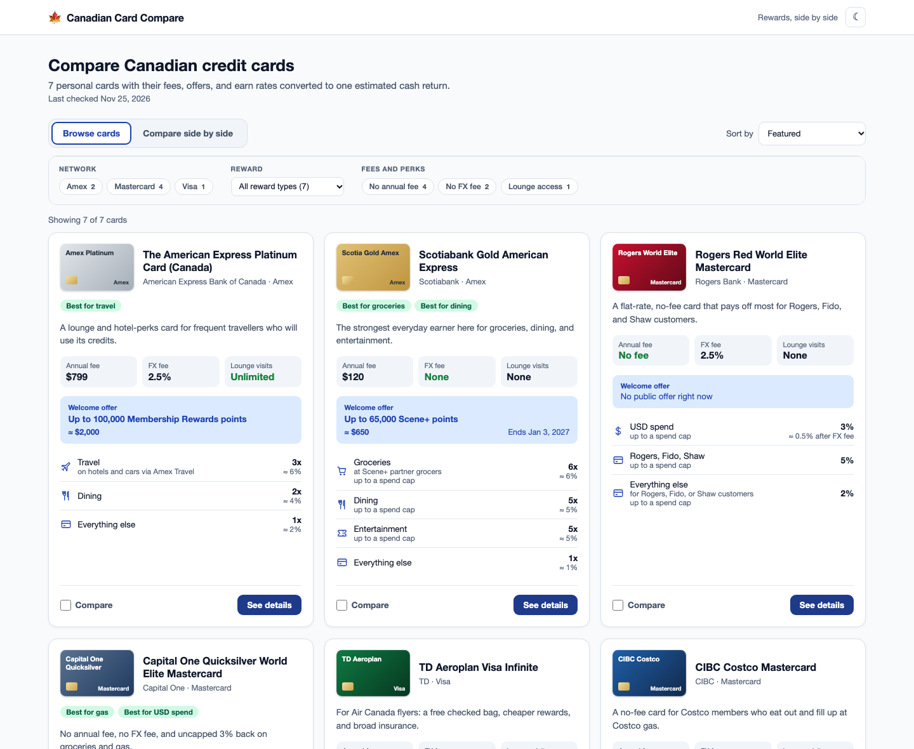
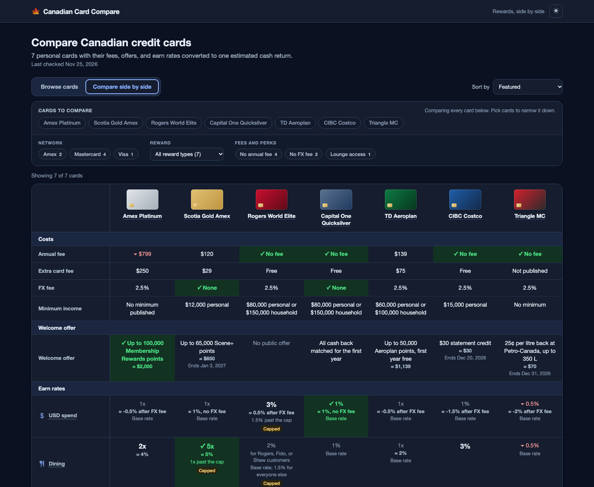
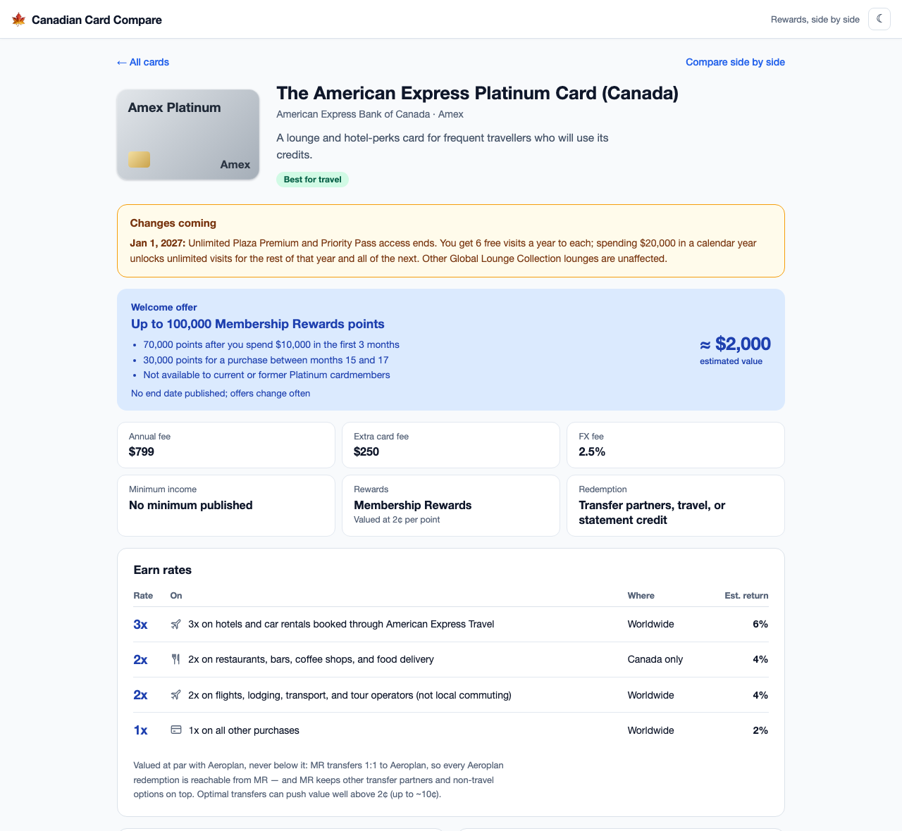

# Canadian Credit Card Comparison

A fast, fully static web app that compares Canadian personal credit cards
side-by-side and normalizes their rewards — points, Membership Rewards, and
cashback — into a single **estimated cash value** so cards with different reward
currencies can be judged apples-to-apples.


> **Disclaimer:** This is a personal side project for learning and comparison. The
> card data is hand-curated, illustrative, and may be out of date or incomplete.
> Reward valuations are estimates, not guarantees. **Nothing here is
> financial advice** — always confirm details against the issuer's official terms.

## What it does

- **Browse view** (`/`) — one tile per card: fees, welcome offer with its estimated
  value and end date, top earn rates, and "Best for" badges. Sort by annual fee,
  welcome offer, or best return in any category, and tick **Compare** to collect
  cards in a tray.
- **Comparison matrix** (`/?view=compare`) — the picked cards (or all of them) as
  columns and their attributes as grouped rows: costs, welcome offer, earn rates,
  travel and protection, rewards. The card names and row labels stay in view while
  you scroll. The best value in each numeric row is highlighted green and the
  weakest marked red, recomputed over whatever is on screen. Equal returns are
  decided by coverage (a rate for the whole category beats one for certain stores),
  then by how easily the reward redeems.
- **First-year match** — a toggle that includes offers matching everything a card earns
  in its first year, and re-ranks with them. Any limit on the match is shown.
- **Rogers customer** — on by default; turn it off to rank Rogers at its 1.5% rate for
  people without Rogers, Fido, or Shaw service.
- **Filters that can't dead-end** — network, reward type, no annual fee, no FX fee,
  and lounge access. Each filter shows a live count and disables itself when it
  would leave no cards; applied filters appear as removable tags.
- **Shareable state** — the view, sort, picked cards, and filters live in the URL,
  so a comparison can be sent to someone and survives a trip to a detail page.
- **Normalized rewards** — a 2x Membership Rewards rate, a 5x points rate, and a 3%
  cashback rate are converted to a comparable estimated percentage value, so
  rankings are fair across reward currencies.
- **Fallback-aware cells** — an accelerated rate is shown with its condition and
  what you get otherwise (e.g. "6x at Scene+ partner grocers, 5x elsewhere", or
  "3% … 1.5% past the cap"). US-dollar spend is ranked net of the FX fee.
- **Categories, explained where you need them** — every category row label links
  to its definition in the "What counts in each category?" reference below the
  table: what typically counts, plus its most common merchant-coding gotcha
  (e.g. Walmart and Costco usually don't code as groceries). Clicking a label
  opens the reference and highlights that entry; a hover tooltip carries the
  same definition as a mouse shortcut. Rows and reference render from one typed
  category registry, so the table and its definitions can't drift.
- **Per-card detail pages** (`/[id]`) — announced changes, the welcome offer, earn
  rates with their estimated return, caps, reasons to get or skip the card, perks,
  insurance limits, and links to every source, with the date the record was last
  checked. Each page is statically generated at build time.

## Screenshots

**Browse** (`/`) — what each card costs, earns, and offers right now:



**Compare** (`/?view=compare`) — the same data side by side, here in dark mode:



**Card detail** (`/[id]`) — announced changes, offer, earn rates, insurance, and sources:



## Tech stack

- **[Next.js 16](https://nextjs.org/)** (App Router, Turbopack)
- **React 19** + **TypeScript** (`strict`, plus `noUncheckedIndexedAccess` and
  friends)
- **CSS Modules** — no CSS framework, no runtime CSS-in-JS
- **Dark mode** — a semantic design-token layer (CSS custom properties) that
  follows the OS `prefers-color-scheme` with no JavaScript, plus a header toggle
  that persists an explicit override
- **[oxlint](https://oxc.rs/)** for linting (correctness + suspicious + a curated
  set of stricter rules, including `jsx-a11y` accessibility checks)
- **Static Site Generation** — no backend, no database; all data is versioned in
  the repo and every route is prerendered

Card data is stored as typed TypeScript ([`src/data/cards.ts`](./src/data/cards.ts)),
so the whole portfolio is version-controlled and updating an issuer's benefits is a
simple, reviewable diff.

## Getting started

**Prerequisites:** [Node.js](https://nodejs.org/) ≥ 20.9 and
[pnpm](https://pnpm.io/) (the repo pins pnpm via the `packageManager` field; npm
also works).

```bash
# install dependencies
pnpm install

# start the dev server (http://localhost:3000)
pnpm dev

# create an optimized production build
pnpm build

# serve the production build
pnpm start
```

## Scripts

| Script            | Description                                                         |
| ----------------- | ------------------------------------------------------------------- |
| `pnpm dev`        | Start the Next.js dev server.                                       |
| `pnpm build`      | Production build (every route prerendered as static/SSG).           |
| `pnpm start`      | Serve the production build.                                         |
| `pnpm lint`       | Lint with oxlint (correctness + suspicious + curated strict rules). |
| `pnpm lint:fix`   | Lint and auto-fix.                                                  |
| `pnpm typecheck`  | Type-check with `tsc --noEmit` (strict, no build output).           |
| `pnpm test`       | Run the Vitest unit suite.                                          |
| `pnpm test:watch` | Run Vitest in watch mode.                                           |

## Project structure

```
src/
├── app/         # App Router routes, layout, and route-scoped CSS Modules
├── components/  # Client UI island (CardExplorer orchestrator + focused pieces)
├── data/        # Card portfolio, reward-value profiles, category registry
├── lib/         # Pure logic: valuation, comparison, formatting
└── types/       # Shared domain model (Card, EarnRate, RewardValueProfile, …)
```

The layering is deliberate: `lib/` holds pure functions with **no** React/Next
imports, so the valuation and comparison logic is easy to test and reason about
independently of the UI. See **[ARCHITECTURE.md](./ARCHITECTURE.md)** for a full
walkthrough of the domain model, the reward-valuation method, and the
comparison-matrix logic.

## How the valuation works (in one line)

```
estimatedValuePercent = earnRate.rateMultiplier × rewardValueProfile.value
```

Every earn rate is normalized through its card's reward-value profile (e.g.
Membership Rewards at 2.0¢/pt, cash back at 1.0¢). The comparison ranks on this
normalized value while still **displaying** each card's native rate (`x` for
points, `%` for cash back). One deliberate stance — the **transfer floor**: a
transferable currency is never valued below its best 1:1 transfer partner, which
is why Membership Rewards (1:1 to Aeroplan, plus other partners) and Aeroplan
are both valued at 2.0¢. Crucially, **how easily** a reward redeems is tracked
_separately_ (a `redemption` flexibility score, shown as its own row and used to
break ties when two cards earn the same estimated value) — so store-locked
Canadian Tire Money isn't confused with universal cash back even though both are
worth 1¢. Full details in
[ARCHITECTURE.md](./ARCHITECTURE.md).

## Adding or updating cards

1. Add or edit a `Card` object in [`src/data/cards.ts`](./src/data/cards.ts), and set
   `verifiedOn` to the day you checked it. An announced change goes in
   `upcomingChanges` until it takes effect; then move it into the card's own fields.
2. If it uses a new reward currency, add a profile to
   [`src/data/rewardValuations.ts`](./src/data/rewardValuations.ts).
3. Run `pnpm lint && pnpm typecheck && pnpm build`.

The card automatically appears in the comparison matrix (and its filters) and gets
its own statically generated detail page.

## License

Released under the [MIT License](./LICENSE).
